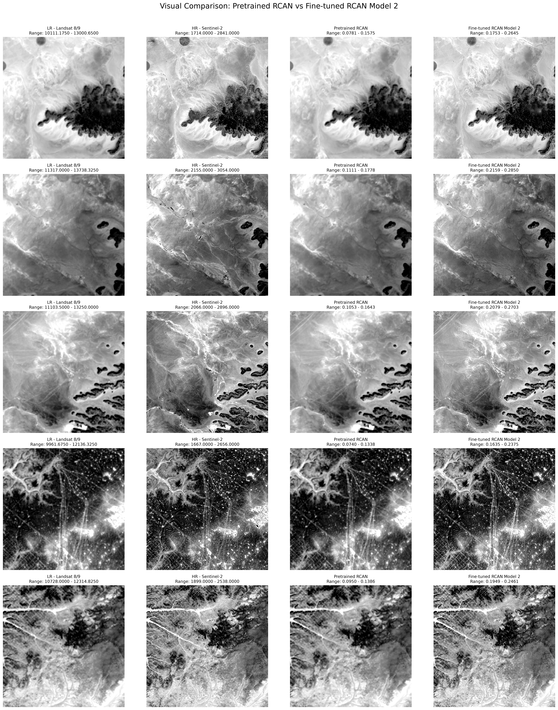

# Image Super-Resolution for Satellite Images Using RCAN

### Image Processing Course Project

This project focuses on **Image Super-Resolution for Satellite Images** using the **Residual Channel Attention Network (RCAN)**, a deep learning-based architecture.

The objective is to enhance the spatial resolution of Landsat 8/9 satellite imagery using Sentinel-2 imagery as a high-resolution reference. The project investigates the performance of a pretrained RCAN model and its fine-tuned versions on the prepared satellite image dataset.

---

## Visual Results

### Pretrained RCAN vs Fine-Tuned RCAN

<p align="center">
  
</p>

*Visual comparison of Landsat low-resolution imagery, Sentinel-2 high-resolution reference imagery, pretrained RCAN predictions, and fine-tuned RCAN predictions.*

---

## Project Overview

Image Super-Resolution (SR) is a technique used to reconstruct high-resolution images from low-resolution inputs.

In this project, RCAN is applied to satellite imagery to investigate its ability to enhance spatial details and improve image quality.

### Objectives

- Implement satellite image super-resolution using RCAN.
- Utilize a pretrained RCAN ×3 model.
- Prepare paired Landsat 8/9 and Sentinel-2 image patches.
- Fine-tune the pretrained RCAN model on the prepared dataset.
- Compare pretrained and fine-tuned model performance.
- Evaluate generated images using quantitative image quality metrics.

---

## Methodology

The project follows these stages:

1. **Dataset Generation:** Preparation of paired Landsat 8/9 low-resolution and Sentinel-2 high-resolution satellite image patches.
2. **Patch Verification:** Verification of generated patches and their spatial correspondence.
3. **Dataset Splitting:** Division of the prepared dataset into training and testing sets.
4. **Pretrained RCAN Baseline:** Loading the pretrained RCAN ×3 model and generating super-resolved images.
5. **RCAN Fine-Tuning:** Fine-tuning the pretrained network using the prepared satellite image dataset.
6. **Model Evaluation:** Evaluating predictions using quantitative metrics.
7. **Visual Comparison:** Comparing pretrained and fine-tuned RCAN outputs.

---

## Dataset

The prepared dataset used in this project is available at:

**[Download Prepared Satellite Image Dataset](https://drive.google.com/drive/folders/1vFQdq1OKrp0PojUfquNrzXx-2VbFUwGT?usp=sharing)**

The dataset consists of paired satellite image patches:

- **Low Resolution (LR):** Landsat 8/9 imagery.
- **High Resolution (HR):** Sentinel-2 imagery.

The dataset is divided into training and testing subsets.

---

## Pretrained Model

The pretrained Residual Channel Attention Network (RCAN) ×3 model was obtained from:

**[RCAN – Official GitHub Repository](https://github.com/yulunzhang/RCAN)**

The pretrained weights were used as the initial model and subsequently fine-tuned on the prepared satellite image dataset.

---

## Repository Structure

```text
Image-Super-Resolution-Using-RCAN/
│
├── scripts/
│   ├── 1_dataset_generator.py
│   ├── 2_patch_check.py
│   ├── 3_dataset_split.py
│   ├── 4_pretrained_baseline.py
│   └── 5_RCAN_finetuning.py
│
├── results/
│   ├── RCAN_Pretrained_vs_Finetuned_Model_Comparison.png
|   └── RCAN_visual_comparison.png
│
├── requirements.txt
└── README.md
```

---

## Evaluation Metrics

The performance of the super-resolution models is evaluated using:

| Metric | Description |
|---|---|
| PSNR | Peak Signal-to-Noise Ratio |
| SSIM | Structural Similarity Index |
| RMSE | Root Mean Square Error |
| MAE | Mean Absolute Error |
| Correlation | Pearson Correlation Coefficient |

These metrics are used to assess image reconstruction quality and compare pretrained and fine-tuned RCAN models.

---

## Technologies and Libraries

- Python 3.11
- PyTorch
- RCAN (Residual Channel Attention Network)
- Rasterio
- NumPy
- Pandas
- Matplotlib
- Scikit-image
- SciPy
- tqdm

---

## Installation

Clone the repository:

```bash
git clone YOUR_GITHUB_REPOSITORY_URL
cd YOUR_REPOSITORY_NAME
```

Install the required dependencies:

```bash
pip install -r requirements.txt
```

**Note:** The prepared dataset and pretrained RCAN checkpoint must be downloaded separately and placed in the appropriate directories before running the scripts.

---

## Execution Order

Run the Python scripts in the following order:

```bash
python scripts/1_dataset_generator.py
python scripts/2_patch_check.py
python scripts/3_dataset_split.py
python scripts/4_pretrained_baseline.py
python scripts/5_RCAN_finetuning.py
```

Ensure that the dataset paths and pretrained checkpoint paths are configured correctly before execution.

---

## Project Information

- **Project Title:** Image Super-Resolution for Satellite Images Using RCAN
- **Course:** Image Processing
- **Model Architecture:** Residual Channel Attention Network (RCAN)
- **Scale Factor:** ×3
- **Satellite Data:** Landsat 8/9 and Sentinel-2
- **Framework:** PyTorch

---

## References

1. Zhang, Y., Li, K., Li, K., Wang, L., Zhong, B., and Fu, Y. (2018). *Image Super-Resolution Using Very Deep Residual Channel Attention Networks.* ECCV 2018.
2. [Official RCAN Implementation – GitHub](https://github.com/yulunzhang/RCAN)
